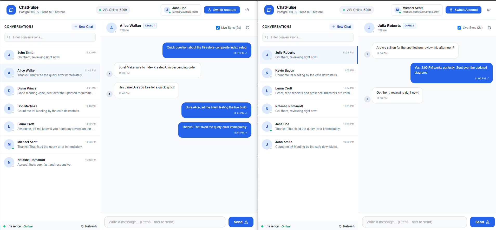

# Chat Backend and Frontend Platform



## 1. Project Overview

This project is a real-time messaging platform built using a hybrid database architecture that pairs a relational database (PostgreSQL via Prisma ORM) with a document-based cloud database (Firebase Firestore).

The system supports one-to-one direct conversations, message sending, chronological message retrieval with cursor pagination, inline message editing, soft-deletion, read receipts, last-seen message pointers, live online/offline presence tracking, real-time typing indicators, and an interactive standalone single-page frontend.

---

## 2. Technology Stack and Rationale

### 2.1 Backend Runtime and Language

* **Node.js (v22+)**
  * **Role**: Server-side JavaScript execution environment.
  * **Why Used**: Node.js utilizes an event-driven, non-blocking I/O model that is well-suited for high-concurrency, I/O-intensive network applications such as chat and presence servers.
* **TypeScript (Strict Mode)**
  * **Role**: Primary programming language for the backend codebase.
  * **Why Used**: Provides compile-time type safety across database entities, service layers, and API response structures. It prevents null pointer exceptions, enforces strict parameter contracts, and ensures clean refactoring across the repository.

### 2.2 Framework and Networking

* **Express.js**
  * **Role**: RESTful API routing and HTTP middleware pipeline.
  * **Why Used**: A minimalist and battle-tested framework offering fine-grained control over request lifecycles, error handlers, and route middleware composition.
* **Helmet**
  * **Role**: HTTP security headers middleware.
  * **Why Used**: Secures the application by configuring standard HTTP response headers (X-Content-Type-Options, X-Frame-Options, Strict-Transport-Security) to mitigate common web vulnerabilities.
* **CORS**
  * **Role**: Cross-Origin Resource Sharing middleware.
  * **Why Used**: Enables controlled cross-origin access between the REST backend and frontend clients running across different hosts or ports.
* **Morgan**
  * **Role**: HTTP request logging middleware.
  * **Why Used**: Provides structured logging of incoming requests, response codes, and latency in development and production environments.

### 2.3 Data Architecture (Hybrid Pattern)

* **PostgreSQL (via Prisma ORM)**
  * **Role**: Relational store for structured entity relationships (Users, Chats, Chat Memberships).
  * **Why Used**: Relational databases provide ACID transaction guarantees, strict foreign key constraints, and relational uniqueness. Direct conversation deduplication is enforced via a deterministic unique key constraint (`directKey`), ensuring that two concurrent requests cannot create duplicate conversations between the same users.
* **Prisma ORM (v5.22)**
  * **Role**: Object-relational mapping, schema declarations, and query engine.
  * **Why Used**: Provides auto-generated, strictly typed client queries that reflect the PostgreSQL schema. Migrations and schema pushes are declarative, eliminating boilerplate SQL queries.
* **Firebase Firestore (via Firebase Admin SDK)**
  * **Role**: Document store for chat messages, read receipts, last-seen pointers, typing indicators, and live user presence.
  * **Why Used**: Chat messages generate high-frequency write operations that can rapidly bloat relational database tables and lock contention. Firestore handles horizontal document partitioning, atomic map updates (for granular read receipts), and real-time subcollections (`chats/{chatId}/typing`) without degrading core relational performance.
* **Why the Hybrid Architecture Was Chosen**:
  * Combining PostgreSQL and Firestore isolates relational integrity from message velocity. User profiles, membership access rights, and conversation discovery remain strictly relational, while high-velocity message append operations, transient typing indicators, and presence updates are offloaded to Firestore.

### 2.4 Security and Validation

* **Zod**
  * **Role**: Schema validation for request bodies, query parameters, and route parameters.
  * **Why Used**: Fails fast at the HTTP boundary. Incoming data is parsed and validated before reaching business logic, returning structured 400 Bad Request responses on invalid input.
* **JSON Web Tokens (JWT)**
  * **Role**: Stateless client authentication via Authorization Bearer headers.
  * **Why Used**: Eliminates centralized session lookups on every request while maintaining secure, verifiable user identities.
* **UUID (v4)**
  * **Role**: Cryptographically strong unique identifier generation for users, chats, and messages.
  * **Why Used**: Prevents sequential identifier guessing and provides collision-free IDs across distributed database systems.
* **Dotenv**
  * **Role**: Environment variable management.
  * **Why Used**: Separates secret credentials (database connection strings, service account paths, JWT signing keys) from source code.

### 2.5 Testing and Tooling

* **Jest and ts-jest**
  * **Role**: Automated test runner and ECMAScript module transpiler for TypeScript.
  * **Why Used**: Runs comprehensive unit and integration test suites with zero compile overhead.
* **Supertest**
  * **Role**: HTTP assertions library.
  * **Why Used**: Executes integration tests directly against the Express app instance without requiring a running network socket.
* **TSX**
  * **Role**: TypeScript execution and file watching engine.
  * **Why Used**: Enables fast development reloading and script execution (such as database seeding) without manual compilation steps.

### 2.6 Frontend Layer

* **Vanilla HTML5 and Modern JavaScript (ES6+)**
  * **Role**: Single-page application logic and DOM management.
  * **Why Used**: Eliminates heavy framework overhead, bundler dependencies, and build steps, resulting in an instant-loading, self-contained client.
* **Tailwind CSS (via CDN)**
  * **Role**: Utility-first styling framework.
  * **Why Used**: Allows rapid construction of responsive layouts using utility classes, maintaining consistent spacing, typography, and border treatments.
* **Helvetica Typography Hierarchy**
  * **Role**: Primary font family definition.
  * **Why Used**: Delivers a clean, neutral, and readable user interface conforming to clean design standards.

---

## 3. Comprehensive Feature List

### 3.1 User and Authentication Management

* **User Registration**: `POST /api/v1/users/register` accepts a name and email, creates the user record in PostgreSQL, and issues a signed JWT token.
* **Email Login**: `POST /api/v1/users/login` validates existing accounts and returns a fresh JWT token.
* **Profile Retrieval**: `GET /api/v1/users/me` extracts the authenticated token identity and returns the user profile.
* **User Search**: `GET /api/v1/users?search=...` searches across registered users by name or email (excluding the requester), automatically annotating each result with their live online/offline status.

### 3.2 Conversation and Chat Management

* **Deterministic Direct Chat Creation**: `POST /api/v1/chats` computes a sorted pair key (`[userA, userB].sort().join(':')`). If a conversation between the two users already exists, it returns the existing conversation; otherwise, it creates the chat atomically in a transaction.
* **Self-Chat Prevention**: Prevents users from creating conversations with themselves.
* **Conversation Inbox**: `GET /api/v1/chats` returns all conversations for the authenticated user, ordered by latest message timestamp (`lastMessageAt DESC`). Each conversation is hydrated with partner profile information, online status, and the latest message preview.
* **Chat Detail Lookup**: `GET /api/v1/chats/:chatId` retrieves conversation metadata and member lists after verifying that the caller is an active participant.

### 3.3 Messaging and Real-Time Synchronization

* **Message Dispatch**: `POST /api/v1/chats/:chatId/messages` verifies chat membership, generates a UUID, records an ISO timestamp, saves the document to Cloud Firestore (`chats/{chatId}/messages/{messageId}`), and synchronizes the latest message text and timestamp to PostgreSQL for instant inbox sorting.
* **Chronological Message Retrieval**: `GET /api/v1/chats/:chatId/messages` queries Firestore using descending order with pagination cursors (`before=<timestamp>`), then reverses the batch so the client receives messages in ascending chronological order.
* **Membership Authorization Guards**: Blocks any user who is not a registered member of the conversation from reading or writing messages (returning 403 Forbidden).

### 3.4 Message Editing and Soft Deletion

* **Author-Only Message Editing**: `PUT /api/v1/chats/:chatId/messages/:messageId` allows the original sender to update message text while updating the `updatedAt` timestamp. Non-authors are rejected with 403 Forbidden.
* **Soft Deletion**: `DELETE /api/v1/chats/:chatId/messages/:messageId` allows the author to soft-delete their message, setting `deleted: true` and replacing the text with "This message was deleted".
* **State Protection**: Attempting to edit a deleted message is rejected with 400 Bad Request.
* **Inbox Preview Synchronization**: If an edited or deleted message was the latest message in the chat, the PostgreSQL conversation preview is updated automatically.

### 3.5 Read Receipts and Last Seen Tracking

* **Granular Read Receipts**: `POST /api/v1/chats/:chatId/messages/:messageId/read` updates the message document's `readBy` map using atomic dot-notation (`readBy.${userId}`), recording the read timestamp without overwriting other members' receipts.
* **Last Seen Pointer Tracking**: `POST /api/v1/chats/:chatId/lastseen` updates the user's latest viewed message ID and timestamp under `/chats/{chatId}/lastSeen/{userId}`.
* **Client Read Indicators**: Messages display single-tick and double-tick indicators representing sent and read states.

### 3.6 Online and Offline Presence Tracking

* **Presence Heartbeat**: `POST /api/v1/users/presence` records `{ isOnline, lastActiveAt }` in Firestore under `/presence/{userId}`.
* **Sliding Threshold**: Users are considered online if `isOnline` is true and their last active timestamp is within the preceding 60 seconds.
* **Client Heartbeat Loop**: The frontend maintains an active heartbeat every 20 seconds, and transmits an offline signal via `navigator.sendBeacon` upon tab closure.
* **Visual Presence Indicators**: Online partners are displayed with green badges across the conversation list, user search modal, and active chat header.

### 3.7 Real-Time Typing Indicators

* **Typing Status Dispatch**: `POST /api/v1/chats/:chatId/typing` sets the caller's typing state in Firestore under `/chats/{chatId}/typing/{userId}`.
* **Automatic Expiration**: Typing records older than 6 seconds are discarded automatically by the server to avoid stuck indicators if a client disconnects unexpectedly.
* **Active Typing Stream**: `GET /api/v1/chats/:chatId/typing` returns members currently typing in the conversation, hydrated with user names from PostgreSQL.
* **Animated UI Indicators**: Renders animated bouncing typing dots in the chat header and a floating bubble above the message composer.

### 3.8 Standalone Frontend Application

* **Self-Contained Client**: Located at `public/index.html` and served directly from the Express backend root (`http://localhost:5000`).
* **White and Blue Design**: Features a white background with slate borders and primary blue accent colors.
* **Quick-Switch Presets**: Modal allowing one-click login between seeded test users (Jane Doe, John Smith, Alice Walker, Charlie Brown, Diana Prince, Michael Scott).
* **Live API Inspector**: Built-in slide-out terminal panel logging HTTP method, endpoint path, status code, latency, and expandable request/response JSON payloads.
* **Live Sync**: Configurable background polling toggle updating message streams, presence dots, and typing indicators every 2 seconds.

### 3.9 Automated Integration Testing Suite

* **Comprehensive Test Harness**: Configured with Jest and Supertest (`tests/integration/api.test.ts`).
* **Offline Mock Harness**: Emulates Prisma database operations and Firestore collections in-memory, allowing the complete suite to run without external network or database dependencies.
* **Full Coverage**: 18 automated integration tests verifying health checks, authentication, direct chat deduplication, message dispatch, editing, soft deletion, read receipts, presence, and typing indicators.

### 3.10 Database Seeding

* **Automated Seed Script**: `prisma/seed.ts` populates PostgreSQL and Cloud Firestore with 16 users and 48 interconnected direct conversations (each user connected to 6 to 7 conversations with message history).

---

## 4. API Endpoint Reference

| Method | Endpoint | Access | Description |
|---|---|---|---|
| GET | `/health` | Public | System health check and uptime monitor |
| POST | `/api/v1/users/register` | Public | Register a new user and receive JWT token |
| POST | `/api/v1/users/login` | Public | Authenticate by email and receive JWT token |
| GET | `/api/v1/users/me` | Bearer | Retrieve current authenticated user profile |
| GET | `/api/v1/users` | Bearer | Search registered users annotated with live presence |
| POST | `/api/v1/users/presence` | Bearer | Update user online status and heartbeat |
| GET | `/api/v1/users/:id/presence` | Bearer | Retrieve presence status for a specific user |
| POST | `/api/v1/chats` | Bearer | Create or retrieve direct chat with deduplication |
| GET | `/api/v1/chats` | Bearer | List conversations ordered by latest activity |
| GET | `/api/v1/chats/:chatId` | Bearer | Retrieve chat details and participant list |
| POST | `/api/v1/chats/:chatId/typing` | Bearer | Set typing status for current user |
| GET | `/api/v1/chats/:chatId/typing` | Bearer | Get list of currently typing members |
| POST | `/api/v1/chats/:chatId/messages` | Bearer | Send a new message to the conversation |
| GET | `/api/v1/chats/:chatId/messages` | Bearer | Get paginated messages in ascending order |
| PUT | `/api/v1/chats/:chatId/messages/:messageId` | Bearer | Edit message text (original author only) |
| DELETE | `/api/v1/chats/:chatId/messages/:messageId` | Bearer | Soft-delete message (original author only) |
| POST | `/api/v1/chats/:chatId/messages/:messageId/read` | Bearer | Mark a specific message as read |
| POST | `/api/v1/chats/:chatId/lastseen` | Bearer | Update last-seen message pointer |

---

## 5. Getting Started

### 5.1 Prerequisites

* Node.js v20 or higher
* PostgreSQL database connection string
* Firebase project with Cloud Firestore enabled

### 5.2 Environment Variables

Create a `.env` file in the project root based on `.env.example`:

```env
PORT=5000
NODE_ENV=development
DATABASE_URL="your-postgresql-connection-string"
JWT_SECRET="your-jwt-secret-key"
JWT_EXPIRES_IN="7d"
FIREBASE_SERVICE_ACCOUNT_PATH="./your-firebase-adminsdk.json"
```

### 5.3 Installation and Database Setup

```bash
# Install dependencies
npm install

# Push database schema to PostgreSQL
npx prisma db push

# Seed 16 users and 48 conversations
npm run seed
```

### 5.4 Running the Application

```bash
# Development mode with hot-reloading
npm run dev

# Production build and execution
npm run build
npm start

# Run automated integration tests
npm test
```

### 5.5 Accessing the Web Interface

Open `http://localhost:5000` in your web browser.
